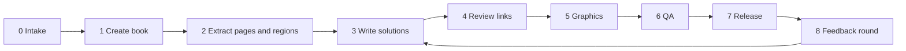

# Workflow: from two PDFs to a live book

This is the standard pipeline for adding a chapter to the databank. It is the JM26 (B) build, reordered and simplified: everything that took a feedback round on JM26 (B) is now a default from the start (see "Defaults learned from JM26 (B)" at the end).



| Stage | Output | Tool | Typical effort |
| --- | --- | --- | --- |
| 0 Intake | chapter brief | — | 5 min |
| 1 Create | `books/<id>/` with the PDFs | `new_book.py` | 1 min |
| 2 Extract | `book.json` question list, `pages/`, `layout.json`, teacher crops | `extract_pages.py`, `extract_ans_refs.py` | 30 min |
| 3 Solutions | `solutions.js` | ANS crops | the largest step |
| 4 Links | `links` in `solutions.js` | `check_book.mjs` | medium |
| 5 Graphics | `widgets.js` | `engine/widgets/kit.js` | large |
| 6 QA | report and screenshots | `check_book.mjs --shots` | 30 min |
| 7 Release | live link | git, GitHub Pages | 5 min |

---

## Stage 0: Intake

What is needed from the teacher for each chapter:

- [ ] The **QUE PDF**: the question notes with blank answer spaces. Its pages become the ebook's background.
- [ ] The **ANS PDF**: the same notes with the teacher's working in red-bordered boxes. This defines the method every solution must follow.
- [ ] The **form, code and title** as printed, e.g. S3 · JM26 (B) · Inequalities I.
- [ ] Any **special requests**, for example a particular graphic ("Q2: fix the side at 3, slider for the number of sides").

Decide and note in the chapter log (`docs/chapters/<id>.md`):

- the **book id**: short, lower case, never renamed later, e.g. `jm26b`. It names the saved-ink store on every iPad;
- the **sections** for the top bar, from the section titles in the notes (e.g. Practical, MC, Challenge);
- which questions are **printed worked examples**. Their answer is already on the page, so they get only a graphic button.

## Stage 1: Create the book

```powershell
python tools/new_book.py <id> --form S3 --code "JM27 (A)" --title "Inequalities II" --topic Inequalities --que "<path>\...(QUE).pdf" --ans "<path>\...(ANS).pdf"
```

This copies `books/_template/`, puts both PDFs in `books/<id>/source/`, fills in `book.json`, and adds the book to `books/catalog.json` with status `draft`. Also copy `docs/chapters/_template.md` to `docs/chapters/<id>.md`.

## Stage 2: Extract pages and answer regions

1. **Draft the question list:**
   ```powershell
   python tools/extract_pages.py <id> --scan
   ```
   This prints the section titles it finds, and a JSON draft of every numbered question and Example/Practice heading with its page. Copy it into `book.json` → `extract.questions`, then:
   - give each item a `section` id from `book.json` → `sections`;
   - use the standard ids: `ex1`, `ex2` for examples, `p1a`, `p1b`, `p2` for practices, `q1` … `qN` for numbered questions. `label` is what the jump list shows: "Example 1", "Practice 1a", or just "12" for numbered questions;
   - move each heading's `anchor` regex into `extract.anchors` (`{"ex1": "Example\\s*1"}`). Numbered questions need no anchor: the tool finds "12." at the left margin;
   - delete false hits, such as a section title or a number inside a table.
2. **Render the pages and find regions:**
   ```powershell
   python tools/extract_pages.py <id>
   ```
   This writes `pages/p01.jpg` … (3× zoom, JPEG quality 86) and `layout.json`. Each question's answer region runs from the bottom of its printed text to the next question, or to the footer.
   - `MISSING ANCHOR qX page N` means the label was not found. Fix `anchors`, or pin it with `fixedAnchors` (`"ex2lq": [y0, y1]` in PDF points).
3. **Override regions the gap rule cannot infer** (`extract.overrides`, in PDF points `[x0, y0, x1, y1]` with the origin at the top left; a page is 595 × 842):
   - framed or boxed examples and practices: `region`;
   - MC questions, where the working space sits beside the options: `region`, plus `square` for the printed answer box;
   - an option to circle: `ring`.

   Find coordinates by opening the page image (1 pt = 3 px at zoom 3), or from the words in `layout.json` → `pages[n].text`. Re-run step 2 after every change.
4. **Crop the teacher's working:**
   ```powershell
   python tools/extract_ans_refs.py <id>
   ```
   This writes `reference/ans/pNN_KK.png`, one per red box on ANS page NN, and full-page previews in `reference/ans_pages/`. Check `source.ansPageOffset`: ANS PDFs usually have no cover, so ANS page = QUE page − 1.

## Stage 3: Write the solutions

Write `books/<id>/solutions.js`, one entry per question in `book.json`, in page order. Work from each question's ANS crop and follow [03-authoring-style.md](03-authoring-style.md):

- [ ] **The same method as the teacher**: same variable, same steps, same final sentence.
- [ ] **One revealable step per line**, with a short side reason where a step needs one ("÷ (−2): reverse the sign").
- [ ] Part labels `h("(a)")`, and **one answer box per part** where the key has side-by-side boxes.
- [ ] Every **final answer checked** against the ANS, including MC letters.
- [ ] Printed examples get `printed: true` and `ctlAt: [x, y]` for their graphic button.

Preview as you go (`python -m http.server 8090`, then `http://127.0.0.1:8090/reader.html?book=<id>`). Tap through each question. If one doesn't fit its region, the engine shrinks the text (down to `minScale`, 0.82 by default), then drops `nl()` number lines, then continues the answer on an extra sheet. Prefer `flow: "col"`, explicit box `w`, or a lower `minScale` over continuation sheets.

## Stage 4: Review links

For every word problem, add `links` that tie key wording in the question to the matching part of the answer (see the links section of [03-authoring-style.md](03-authoring-style.md)):

- `q` phrases must match the printed words exactly. The match ignores case and punctuation;
- mark the answer side with `L(key, tex)` inside maths, `lk(key, step)` for a whole line, or `[[key|words]]` inside text;
- run `node tools/qa/check_book.mjs <id>`: it lists every phrase that is not found on the page, and every link with no marked answer part.

## Stage 5: Graphics

Add a graphic wherever a picture makes the reasoning visible. Each graphic lives in `books/<id>/widgets.js` and is listed in `REGISTRY`. Start from the pattern in `books/_template/widgets.js`, and reuse ideas from `books/jm26b/widgets.js`:

- a question card at the top, with the same "Let …" lines and inequality as the worked solution;
- a picture of the situation, a slider (− / + / ▶) for the unknown, and a live readout (✓ satisfies / ✗ fails);
- quick buttons for the key values ("Least n: 8");
- maths the students have learned; for example, no function graphs for S3 (see the style guide).

## Stage 6: QA

```powershell
cd tools/qa; npm install          # first time only
node check_book.mjs <id> --shots
```

Fix every `FAIL`. Read each `WARN`. Then go through every screenshot in `books/<id>/reference/qa/`, and run the iPad checklist in [04-qa-and-release.md](04-qa-and-release.md).

## Stage 7: Release

1. Set `"status": "live"` in `book.json`.
2. Bump `CACHE` in `sw.js` (e.g. `ebooks-v5` → `ebooks-v6`), so iPads fetch the new files.
3. Commit and push (details in [04-qa-and-release.md](04-qa-and-release.md)). GitHub Pages updates the live link in about a minute.
4. Update the book table in `README.md` and the chapter log.

## Stage 8: Feedback round

The teacher tries the book on the iPad and sends notes. For each round:

- Before a change that alters the look, make a backup copy of the project folder, so it can be reverted in one step.
- Record each decision in `docs/chapters/<id>.md`.
- If a note is about something every book should have, change the engine or this guide, not just the one book.

---

## Defaults learned from JM26 (B)

Each item below was a separate feedback round on JM26 (B). New books get them from the start:

| JM26 (B) feedback | Default now |
| --- | --- |
| "Answers should be inside the answer boxes, with margins" | Answers sit in red-bordered boxes inside the blank region, laid out like the ANS key. |
| "I should be able to click step-by-step answers out" | All steps start hidden; tap for the next step, with ▸ » ◂ ↺ controls and a progress count. |
| "I should be able to switch out of writing mode and scroll" | Read tool at the top of the toolbar; one finger always scrolls. |
| "Graphics are not as developed / not aligned with the questions" | Every graphic opens with a question card and uses the solution's own letters. |
| "Number lines drawn the HKDSE way" | Stem from the value, hollow or filled circle, then the arrow (style guide). |
| "x and y domain questions: mark both domains, colour the overlap" | Two-variable range questions use an x–y picture with both number lines and the overlap shaded. |
| "Hold after drawing a line to make it perfect" | Hold-to-snap for lines, circles, rectangles and triangles. |
| "Let me highlight part of an answer line" | The highlighter snaps to individual characters in maths. |
| "Review highlights linking the question to the answer" | Dashed, tappable review links on every word problem. |
| "Link only what matters" (Q5) | Link a phrase only when it maps to a specific part of the answer. |
| "Use a picture, not a graph of functions" (Q11) | Graphics use pictures, bars and number lines; function graphs only when the students have learned them. |
| "Remove the MC answers in the MC box" | MC answer squares stay empty unless the teacher asks for the letter (`letter`). |
| iPad and Pencil delay, palm, edit ink, undo | Built into the engine for every book. |
