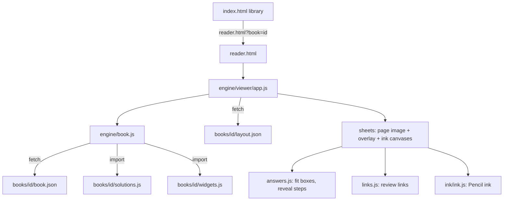

# Engine notes

The engine (`engine/`) is shared by every book. A change here changes all books, so after any engine edit, run `node tools/qa/check_book.mjs <id>` for **every** book in `books/catalog.json`.

## How a book loads

- `book.js` reads `?book=`, loads the book, and exports `BOOK`, `BOOK_DIR`, `STORAGE`, `SOLUTION_BY_ID`, `hasGraphic`, `mountGraphic` and `pageImage`. With no book, or an unknown id, it sends the reader back to the library.
- `app.js` builds one `.sheet` per page: a background ``, an `.overlay` for answers and links, and canvases for highlighter and pen ink. It handles pan and zoom, which use a CSS transform rather than native scrolling, plus toolbars, thumbnails, the jump list, presentation mode and keyboard shortcuts.
- In presentation mode, `showPage()` records the fitted scale in `present.base`. When a pinch has zoomed past it (`presentZoomed()`), one-finger drags pan with momentum instead of turning or springing back the page, and a resize that leaves the width unchanged (Safari bars sliding) keeps the zoom. A one-finger double tap, or pinching back below the fit, returns to `showPage()`.
- `answers.js` fits each question's boxes into its region, trying the scales from 1 down to `minScale` in steps of 0.06:
  1. at scales of 0.76 and above: the full answer, then without the optional number lines, then side-by-side columns (`split()` cuts tall boxes between rendered lines, never right after an `h()` label, and no line may wrap);
  2. below 0.76, at each scale in turn: full, then lean, then columns;
  3. then split the answer onto a continuation sheet (`c<page>-1`), whose header band copies the top `continuation.band` points of the page.
- `media.js` lays each `book.json` `media` entry over its page region: a `<video>` showing its poster (the last frame) plus a round button on the panel's corner. The button carries `data-media`, so the world click handler toggles play, pause and replay in every tool, as it does for `data-act` answer buttons.
- `links.js` finds `q` phrases in `layout.json` text, measures the marked answer parts, and draws the markers, tags and leaders. Question-side markers are dashed (then solid) boxes; answer-side markers are coloured dotted underlines (solid when open), with a transparent hit area so a tap still toggles the link. Nested `.lk-*` pieces drop each underline by 2.6 pt so they stay readable.

## Coordinates

Everything on a sheet uses PDF points (595.32 × 841.92 for A4), the same units as `layout.json`, so overlays line up with the page image at any zoom. Strokes are also saved in points, so ink stays aligned after rotation or a zoom change.

## Storage on the device

| Key | Where | Contents |
| --- | --- | --- |
| `<storage>-ebook` | IndexedDB, store `kv`, key `strokes` | all ink for the book |
| `<storage>-ui` | localStorage | revealed steps per question, tool, toolbar dock, link hints on or off |
| `library-last` | localStorage | the last opened book, for the library's Continue button |

`storage` comes from `book.json`. JM26 (B) uses `jm26b`, which keeps the names from before the databank (`jm26b-ebook`, `jm26b-ui`), so existing ink survived the change.

Safari may delete a website's data if it isn't opened for about a week. Adding the site to the Home Screen protects it. "Save ink file" exports a backup.

## Offline (service worker)

`sw.js` serves code network-first, so a reload picks up changes while online. Images, vendor files and page JPEGs (`/assets/`, `/vendor/`, `/pages/`) are served cache-first. Videos (`/media/*.mp4`) are cached whole and answered from the cache with a 206 slice for each `Range` request, because Safari only plays video that way. **Bump `CACHE` on every release.**

## Ink and Apple Pencil: lessons learned

These cost real debugging time on JM26 (B). Keep them in mind when touching `engine/ink/` or the pointer code in `app.js`:

- **Input model.**
  - Pencil (`pointerType: "pen"`) draws, a finger scrolls and zooms, and a mouse draws.
  - Touches are ignored while the Pencil is down and for 500 ms after (palm rejection).
  - Only the pointer that started a stroke (`activeId`) can move or end it; otherwise a lifting palm ends the Pencil stroke.
- **Safari holds back quick strokes** while it checks for a double tap or a scroll. `claimStylus` calls `preventDefault()` on stylus touch events in drawing tools. `gesturestart` is also prevented, to stop whole-app zoom.
- **`getCoalescedEvents()` is empty on `pointerdown`.** Fall back to the event itself, or the first point is lost and a quick tap leaves no dot.
- **Canvas memory.**
  - iPad Safari limits each canvas to about 16.7 MP, and limits all canvases together by memory.
  - Only pages near the screen that have ink get full-size canvases (`MAX_PIXELS` = 5e6). Pages far away are released to 1 × 1 and repainted on return.
  - Zoomed past that, a canvas covers only the screen plus a margin (`VIEW_MARGIN`, `VIEW_PIXELS`), positioned in page units, so ink stays at screen sharpness. Panning keeps the current view while it still covers the screen, then repaints. The live layer clears only the box it last painted.
  - The stroke in progress is drawn on its own `live` layer; lifting the Pencil adds just that stroke to the page.
- **Saving.** Saves are debounced by 1.5 s and never run mid-stroke. Ink is flushed immediately on `visibilitychange` (hidden) and `pagehide`.
- **Smoothing and pressure.**
  - perfect-freehand with `smoothing` 0.5, `streamline` 0.3 and `last: true`;
  - a pressure curve that lifts light touches;
  - taper scaled to stroke length, so dots survive;
  - predicted events where Safari provides them.
- **Snapping.**
  - Holding still for 520 ms recognises a line, rectangle, ellipse or triangle (`shapes.js`).
  - The highlighter snaps to the text rows of `layout.json`, and to per-character boxes in the revealed answers, so part of a line can be highlighted.
- **Stroke model.**
  - Each stroke is `{ id, page, tool, color, size, points: [{x, y, p, t}], shape?, cut? }`. `page` is the sheet key: `p3`, or `c11-1` for a continuation sheet.
  - Undo history entries are `add`, `swap` (removed/added) and `clear`, capped at 120.
- **Finger gestures.** A two-finger tap undoes and a three-finger tap redoes. Either is cancelled by more than 14 px of movement, or by holding longer than 450 ms.

## Maths rendering

- KaTeX renders with `trust` for `\htmlClass` only; that's how `L()` marks link parts.
- `plain()` in `answers.js` turns each step into readable text for the PDF export.
- Layout runs twice: once at load and again after `document.fonts.ready`, because KaTeX fonts change line widths.

## Testing tips (headless Chrome)

- Emulate the iPad with viewport 1180 × 820, `deviceScaleFactor: 2`, `isMobile` and `hasTouch`.
- Send Pencil input with CDP `Input.dispatchMouseEvent` plus `pointerType: "pen"`, and touches with `Input.dispatchTouchEvent`.
- Keep test points inside the visible viewport; points below it hit `<html>`, not the sheet.
- The reader pans with a transform, so `scrollIntoView` does nothing. Navigate with `location.hash = "<sheet key or question id>"`; a question id wins when it equals a sheet key (`p2`). Fine-tune the position with `page.mouse.wheel`.
- To read saved ink immediately, fake `document.visibilityState = "hidden"` and dispatch `visibilitychange`, then read IndexedDB.
- A static server for tests must send `.mjs` as `text/javascript`, or the freehand module fails to load.
